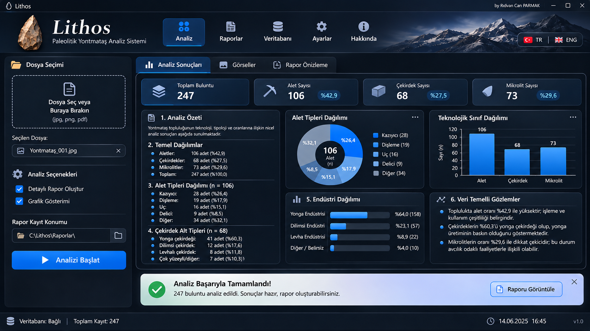

# Lithos — Palaeolithic Lithic Analysis System

**Lithos v1.0.2** is a Windows desktop application for technological, typological and metrical analysis of Palaeolithic chipped-stone assemblages. It reads compatible Microsoft Access databases, presents hierarchical core/tool type and subtype distributions, generates charts and bilingual Word reports, and supports Turkish and English interfaces.

> **Status:** Public source-code release / Windows-build project, **not** a ready-to-install binary. Windows startup and Microsoft Access/ACE operations have to be verified on a compatible Windows system. The approved UI reference image is a **design mock-up**, not a guarantee that every screen is pixel-identical.

## Research origins and vision / Araştırma temeli ve hedefi

**EN —** Lithos began as a research-driven software initiative based on the Microsoft Access database used in Rıdvan Can Parmak's master's research on the **Middle Palaeolithic chipped-stone assemblage of Gürbelen Tepe (Korkuteli, Antalya, Türkiye)**. This case study provided the initial reference for database structure, terminology and analytical workflows; **the original archaeological records are not included in this public repository**.

The project's broader objective is to support **data standardization in Palaeolithic archaeology**, with particular emphasis on consistent documentation of lithic assemblages, transparent technological and typological classification, bilingual terminology, structured data management and reproducible, comparable analyses across research projects. Lithos is an **evolving project**: its current capabilities represent a starting point, not a universal or finalized classification standard. Future development may extend data structures, validation, interoperability, visualization and analytical methods in consultation with researchers.

**TR —** Lithos, **Korkuteli (Antalya) Gürbelen Tepe Orta Paleolitik Çağ yontmataş buluntu topluluğu** üzerine yürüttüğüm yüksek lisans araştırmasında kullandığım Microsoft Access veritabanını başlangıç örneği alan, araştırma odaklı bir yazılım girişimi olarak ortaya çıkmıştır. Bu örnek; veritabanı yapısı, terminoloji ve analiz iş akışlarının ilk geliştirme aşamasına temel oluşturmuştur. **Özgün arkeolojik buluntu kayıtları bu açık depoda paylaşılmamaktadır.**

Projenin daha geniş hedefi, **Paleolitik Çağ arkeolojisinde veri standardizasyonuna** katkıda bulunmaktır. Lithos; yontmataş buluntuların tutarlı belgelenmesini, teknolojik ve tipolojik sınıflandırmaların daha sistematik yürütülmesini, iki dilli terminoloji kullanımını, yapılandırılmış veri yönetimini ve farklı araştırmalar arasında karşılaştırılabilir analizleri desteklemeyi amaçlar. **Lithos gelişime açık bir projedir**; mevcut yapı, tamamlanmış ve evrensel bir sınıflandırma standardı olarak sunulmamaktadır. Gelecek aşamalarda veri doğrulama, birlikte çalışabilirlik, görselleştirme, yeni veri alanları ve analiz yöntemlerinin geliştirilmesi hedeflenmektedir.

## Downloading Lithos / Lithos'u indirme

The project is intended to be distributed in two Windows formats through [GitHub Releases](https://github.com/ridvancanparmak/Lithos-Lithic-Analysis/releases):

- **Setup:** a Windows installer for conventional installation.
- **Portable:** a ZIP archive that can be extracted and run without an installer (system Access/ACE drivers may still be required).

**Release assets should be published only after Windows testing.** At present, the repository is a source-code distribution unless tested `Setup.exe` and Portable ZIP files are attached to a release. A GitHub-generated *Source code (zip)* archive is **not** the Portable application.

**TR —** Kullanıcılar, Windows üzerinde test edilmiş **Setup (kurulum)** ve **Portable (kurulumsuz)** sürümleri yayımlandığında bunları [Releases](https://github.com/ridvancanparmak/Lithos-Lithic-Analysis/releases) bölümünden indirebilecektir. GitHub'ın otomatik sunduğu *Source code (zip)* dosyası çalıştırılabilir Portable paket değildir.

## Features / Özellikler

- Turkish / English (TR / ENG) interface and Word reporting / Türkçe–İngilizce arayüz ve Word raporları
- Hierarchical core, tool type and subtype analysis / Çekirdek, alet tipi ve alt tipine dayalı hiyerarşik analiz
- Frequency, percentages, metrical statistics, bar and pie charts / Frekans, yüzde, ölçüsel istatistikler, çubuk ve pasta grafikler
- Dark user interface with responsive panels / Koyu temalı, farklı pencere boyutlarına uyumlu arayüz
- Windows portable build and optional Inno Setup installer / Portable ve kurulabilir Windows paketleri

## Important: databases / Veritabanları

**Research records are not published here.** The original `GURBELEN-18.accdb`, any derived research database, and user reports are excluded from the public repository. The two blank Access template databases are likewise not included in this source archive.

This version's template-building script derives two blank `.accdb` files from the **original GURBELEN-18 Access schema** on a Windows PC with a compatible Access/ACE/DAO installation. It is not a replacement database schema. You need a source database that you are authorized to use in order to run the template-generation script. See `KULLANIM_TR_EN.md` for the details.

**Araştırma kayıtları yayımlanmıyor.** `GURBELEN-18.accdb` ve diğer gerçek buluntu verileri bu depoda yok. Boş şablonlar, yetkili olduğunuz özgün Gürbelen şeması temel alınarak Windows ortamında üretiliyor.

## Requirements / Gereksinimler

- Windows 10/11, 64-bit
- Python 3.12–3.14 for building (Python 3.15 alone is not the supported build environment)
- Microsoft Access/ACE/DAO components to create and use the `.accdb` templates (matching architecture)
- Inno Setup for the optional Setup.exe

## Building on Windows / Windows derlemesi

1. Download or clone this repository (do not mix with old Lithos hotfix folders).
2. Place your **authorized original** `GURBELEN-18.accdb` next to the `.bat` files if you intend to generate templates; keep your own secure backup.
3. Run `00_HEPSINI_HAZIRLA.bat` for the guided build, or `01_ACCESS_SABLONLARI_OLUSTUR.bat` and `02_PORTABLE_OLUSTUR.bat` separately.
4. Only after the portable startup test passes, run `03_KURULUM_OLUSTUR.bat` to build the optional Windows installer.
5. Never commit the original `.accdb`, generated `Templates/*.accdb`, `dist/`, reports or personal data back to this repository.

**Note:** The source package does not contain a prebuilt EXE or Setup.exe. No Windows build is claimed to have been tested in this environment.

## Structure / Klasörler

- `lithos/` — application, analysis, reporting and data access / uygulama kodu
- `assets/` — icons, flags and header artwork / simgeler ve arayüz görselleri
- `veri_sozlugu/` — bilingual terminology mappings / iki dilli terim sözlükleri
- `tests/` — automated tests / otomatik testler
- `Templates/` — documentation for empty Access templates / boş Access şablon açıklamaları
- `docs/` — visual design reference / tasarım referansı
- `*.bat`, `installer.iss` — Windows build files / Windows derleme dosyaları

## Developer / Geliştirici

Rıdvan Can PARMAK — archaeology, Palaeolithic research and lithic technology.

## License / Lisans

**No open-source license has been selected yet.** Publication of source code on GitHub does not, by itself, give others permission to reuse, redistribute or modify it. If you intend to make Lithos open source, add an explicit license after reviewing the code and third-party asset rights. Until then, all rights are reserved, except as otherwise required by applicable law.

See `GITHUB_YAYINLAMA_REHBERI_TR.md` for publication steps.
